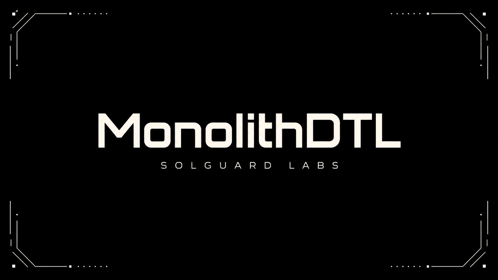

# MonolithDTL



MonolithDTL es una infraestructura Go de settlement centralizado para varios
productos DTL: escrow, vaults, rutas, operadores y redenciones. La CLI ejecuta
escenarios deterministas y emite JSON estable para que los tests TypeScript
validen flujos cruzados entre productos.

El lab modela un monolito operativo donde cada producto conserva su propio
estado de solvencia, pero todos escriben en un ledger global compartido. El
contrato publico de la CLI deja ver balances, deuda global, obligaciones
locales, eventos e invariantes de auditoria.

## Componentes

- `src/ledger.go`: cuentas, activos, reservas y diario global.
- `src/debt_engine.go`: obligaciones locales y proyeccion de deuda comun.
- `src/escrow.go`: lifecycle de escrows y neteo de settlement.
- `src/vault.go`: vaults, shares, lineas de credito y redenciones.
- `src/routes.go`: rutas DTL, legs y liquidacion multi-producto.
- `src/operators.go`: operadores, limites y permisos de producto.
- `src/redemptions.go`: cola de redenciones y ejecucion de claims.
- `src/audit.go`: reconciliacion entre deuda local y global.
- `src/scenarios.go`: escenarios publicos consumidos por tests TS.
- `src/report.go`: serializacion JSON determinista.

## Requisitos

- Go 1.22 o superior.
- Node.js 24 o superior.

## Uso

Compilar:

```bash
npm run build
```

Listar escenarios:

```bash
build/monolithdtl --list
```

Ejecutar escenario:

```bash
build/monolithdtl scenario baseline
```

## Tests

```bash
npm test
```

La suite compila el binario y ejecuta:

```bash
node --test "tests/node/*.test.ts"
```

Los tests cubren contrato de CLI, rutas, operadores, escrows, vaults,
redenciones y una reproduccion determinista del drift entre deuda local y deuda
global compartida.

## Estado Del Lab

Este repositorio esta disenado como CTF autocontenido. No requiere red externa,
nodos ni bases de datos. Todos los escenarios se construyen en memoria y la
salida JSON es el contrato principal de auditoria.

