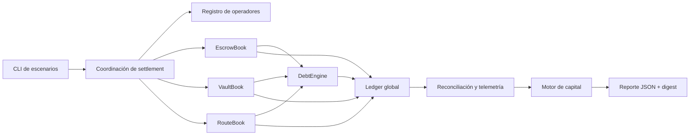
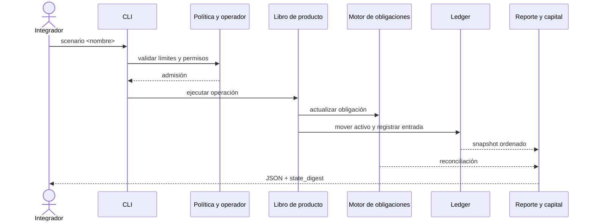
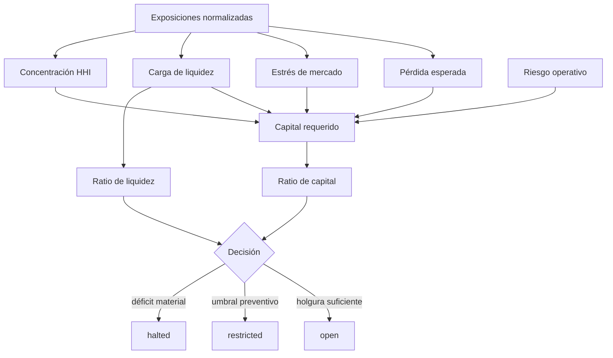
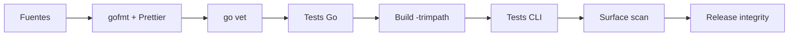

# MonolithDTL


[](https://github.com/SolguardLabs/MonolithDTL/actions/workflows/ci.yml)
[](https://github.com/SolguardLabs/MonolithDTL/actions/workflows/release-integrity.yml)

MonolithDTL es un motor determinista de liquidación multiproducto escrito en Go.
Coordina cuentas, activos, escrow, vaults, rutas, operadores y redenciones sobre
un ledger común, y entrega una vista reproducible del estado operativo mediante
una CLI JSON. El objetivo de diseño es que una misma ejecución pueda auditarse,
repetirse y compararse sin depender de servicios externos.

La versión `1.0.0` incorpora un modelo de capital que calcula pérdida esperada,
estrés de mercado, coste de liquidez, concentración HHI, riesgo operativo y una
escalera de escenarios. Sus decisiones `open`, `restricted` y `halted` se
derivan de ratios explícitos y quedan comprometidas en el digest del reporte.

## Arquitectura



El ledger concentra balances, entradas contables y deuda agregada. Cada libro
de producto conserva además su estado de negocio y emite eventos con identidad,
reloj lógico y referencia estable. La reconciliación no reescribe estado: mide
las diferencias y las expone para control operativo.

| Módulo           | Responsabilidad                                      | Salida principal                   |
| ---------------- | ---------------------------------------------------- | ---------------------------------- |
| `ledger.go`      | Balances, movimientos, deuda agregada y diario       | `LedgerEntry`, eventos y snapshots |
| `debt_engine.go` | Obligaciones y conciliación por producto             | líneas locales y reconciliación    |
| `escrow.go`      | Fondeo, liberación, devolución y captura de comisión | estado de escrow                   |
| `vault.go`       | Depósitos, crédito, repayment y redenciones          | vaults y posiciones                |
| `routes.go`      | Planificación y ejecución de rutas con varias legs   | `RoutePlan`                        |
| `operators.go`   | Autorización, límites y utilización diaria           | `OperatorView`                     |
| `capital.go`     | Capital, liquidez, concentración y escenarios        | `CapitalAssessment`                |
| `report.go`      | Contrato JSON y digest determinista                  | `ScenarioReport`                   |

La documentación de arquitectura completa está en
[`docs/arquitectura.md`](./docs/arquitectura.md).

## Flujo De Liquidación



Cada escenario parte de un contexto nuevo, usa un reloj lógico monótono y ordena
colecciones antes de serializarlas. La misma entrada produce el mismo
`state_digest` en Windows y Linux.

## Modelo De Capital

Para cada exposición `i`, el motor separa tres cargas:

```text
EL_i   = E_i × PD_i × (1 - Recovery_i)
Stress_i = E_i × Vol_i × sqrt(Horizon_i) × StressMultiplier
Liq_i  = E_i × min(LiqCap, (1 - LiquidShare_i) + Days_i × DayCharge)
```

La concentración se calcula por cluster:

```text
share_g = exposure_g / gross_exposure
HHI     = Σ share_g²
ConcentrationCharge = gross_exposure × max(HHI - threshold, 0) × charge_factor
```

El capital requerido agrega las cargas individuales, concentración y riesgo
operativo. La decisión se obtiene con dos razones:

```text
capital_ratio   = available_capital / required_capital
liquidity_ratio = liquid_exposure / short_dated_exposure
```



Un ejemplo numérico completo y las reglas de redondeo están en
[`docs/modelo-economico.md`](./docs/modelo-economico.md).

## Requisitos

- Go `1.22.x` o posterior compatible.
- Node.js `24.x`.
- npm con instalación reproducible mediante `npm ci`.

## Inicio Rápido

```bash
npm ci
npm run build
build/monolithdtl --list
build/monolithdtl scenario baseline
```

En Windows el binario se genera como `build/monolithdtl.exe`.

Escenarios públicos:

| Escenario                | Objetivo operativo                                     |
| ------------------------ | ------------------------------------------------------ |
| `baseline`               | bootstrap, depósitos, crédito y settlement ordinario   |
| `escrow-settlement`      | liberación parcial, devolución y comisión              |
| `vault-redemption-guard` | rechazo de redención bajo deuda activa                 |
| `route-operator-flow`    | ruta de dos legs y consumo de límite                   |
| `capital-stress`         | cartera con vault, escrow y ruta pendiente bajo estrés |

## Contrato De Salida

La CLI escribe un único documento JSON a `stdout` y errores operativos a
`stderr`. Los campos superiores estables son:

```json
{
  "protocol": "MonolithDTL",
  "scenario": "baseline",
  "network_id": "monolith-local-settlement",
  "clock": 42,
  "state_digest": "0123456789abcdef0123456789abcdef",
  "accounts": [],
  "ledger_entries": [],
  "reconciliation": [],
  "invariants": {},
  "risk": {},
  "capital": {
    "required_capital": 0,
    "available_capital": 0,
    "decision": "open",
    "stress_ladder": [],
    "digest": "0123456789abcdef0123456789abcdef"
  }
}
```

Los valores monetarios son enteros en unidades mínimas del activo. No se usan
`float64` en el cálculo financiero. Consulte
[`docs/integracion-cli.md`](./docs/integracion-cli.md) para el esquema, códigos
de salida y pautas de integración.

## Validación

La comprobación completa es idéntica en local y CI:

```bash
npm run ci
```

Incluye:

- `gofmt` y `go vet`;
- tests unitarios Go del modelo de capital;
- build reproducible con `-trimpath`;
- tests de integración TypeScript sobre el binario real;
- formato de documentación y contratos JSON;
- análisis de superficie pública y material sensible;
- integridad de versión, banner y artefactos de release;
- recuento reproducible de líneas no vacías.



La matriz oficial ejecuta el mismo contrato en `ubuntu-latest` y
`windows-latest` para pushes, pull requests, `main`, `production`, ramas
`release/**` y tags `v*`.

## Seguridad Operativa

MonolithDTL aplica permisos por producto, límites diarios de operador, cuentas
congelables, validación de saldos, referencias idempotentes, eventos ordenados,
conciliación y decisiones preventivas de capital. Ningún control individual se
considera suficiente: la operación se observa como una cadena de admisión,
ejecución, contabilización y reconciliación.

La política de divulgación y el proceso de respuesta están en
[`SECURITY.md`](./SECURITY.md). Los runbooks de operación y seguridad están en
[`docs/operacion.md`](./docs/operacion.md) y
[`docs/seguridad-y-riesgo.md`](./docs/seguridad-y-riesgo.md).

## Documentación

- [Arquitectura y límites de responsabilidad](./docs/arquitectura.md)
- [Modelo económico y capital](./docs/modelo-economico.md)
- [Integración de la CLI](./docs/integracion-cli.md)
- [Operación y respuesta](./docs/operacion.md)
- [Seguridad y gestión de riesgo](./docs/seguridad-y-riesgo.md)
- [Contribución](./CONTRIBUTING.md)
- [Cambios de versión](./CHANGELOG.md)

## Release

`Production 1.0.0` es la primera línea estable. La referencia de producción se
publica simultáneamente como rama `production`, tag anotado `v1.0.0` y release
de GitHub. Los tres deben apuntar al mismo commit que `main` antes de anunciar
la entrega.

## Licencia

MIT. Consulte [`LICENSE`](./LICENSE).
