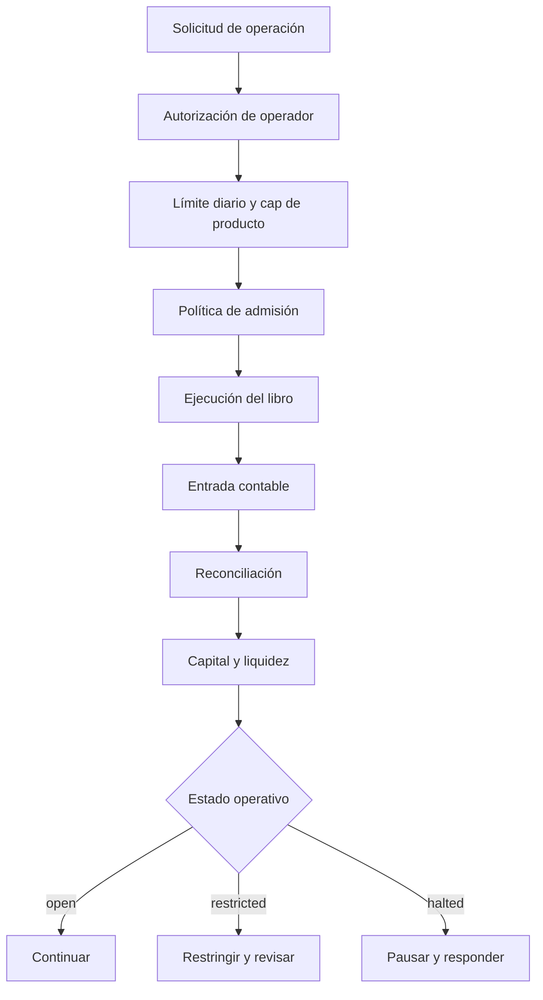
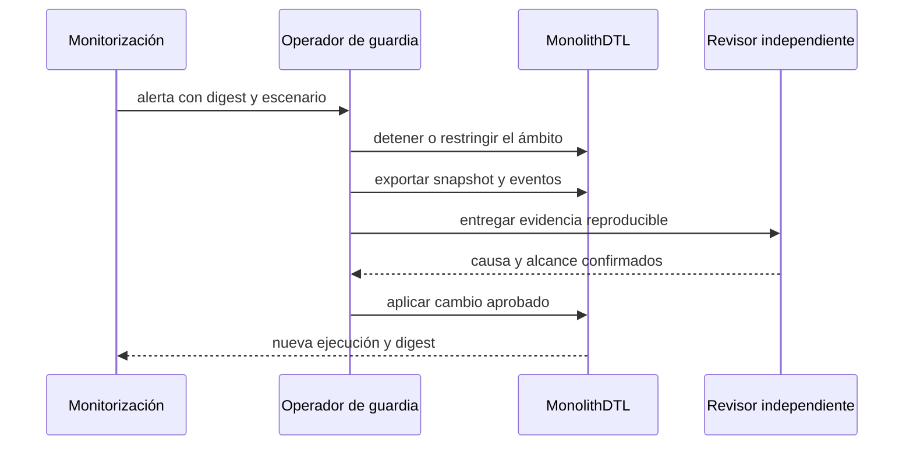

# Política De Seguridad

MonolithDTL procesa estados contables y decisiones de settlement. Los cambios
que afecten balances, deuda, límites, redenciones, capital o serialización deben
tratarse como cambios de alta criticidad aunque no alteren una API visible.

## Versiones Soportadas

| Versión   | Estado           | Actualizaciones de seguridad |
| --------- | ---------------- | ---------------------------- |
| `1.x`     | Soportada        | Sí                           |
| `< 1.0.0` | Fuera de soporte | No                           |

## Divulgación Responsable

Use **GitHub Security Advisories** en este repositorio y seleccione
**Report a vulnerability**. No publique detalles técnicos en issues, pull
requests, discusiones o canales públicos antes de que exista una corrección y
una coordinación de divulgación.

Incluya, cuando sea posible:

1. versión o commit afectado;
2. precondiciones y rol requerido;
3. secuencia mínima de reproducción;
4. impacto sobre balances, obligaciones o disponibilidad;
5. evidencia determinista, sin secretos ni datos personales;
6. propuesta de invariante o prueba de regresión.

El equipo confirmará recepción, reproducirá el comportamiento en un entorno
aislado, clasificará el impacto y coordinará la corrección. Los tiempos dependen
de la complejidad y no constituyen un SLA contractual.

## Modelo De Defensa



Los controles se agrupan en cuatro capas:

- **admisión**: rol, producto autorizado, límites, activo conocido y cantidad;
- **ejecución**: estados válidos, saldos no negativos y referencias estables;
- **contabilidad**: diario, deuda, balances y reloj lógico;
- **supervisión**: invariantes, reconciliación, capital y telemetría.

## Invariantes De Seguridad

Una entrega no se considera válida si falla cualquiera de estas propiedades:

```text
balance(account, asset) >= 0
local_obligation >= 0
operator_used <= operator_daily_limit
sum(route_legs) == route_settled_amount
required_capital > 0 para toda exposición positiva
state_digest(run A) == state_digest(run B) con la misma entrada
```

Las diferencias de reconciliación son señales operativas y no deben corregirse
mediante escrituras automáticas. La remediación exige identificar la fuente,
congelar el ámbito afectado y registrar una entrada compensatoria autorizada.

## Matriz De Riesgo

| Área       | Amenaza                   | Prevención               | Detección                | Respuesta            |
| ---------- | ------------------------- | ------------------------ | ------------------------ | -------------------- |
| Operadores | uso fuera de mandato      | allowlist y caps         | utilización por producto | desactivar operador  |
| Vaults     | salida con deuda activa   | guard de redención       | eventos e invariantes    | pausar vault         |
| Escrow     | transición inválida       | máquina de estados       | estado y reloj lógico    | bloquear settlement  |
| Rutas      | conservación incompleta   | suma de legs y `min_out` | `routes_conserved`       | rechazar ruta        |
| Ledger     | saldo o deuda incoherente | enteros y validaciones   | reconciliación           | congelar cuenta      |
| Capital    | exposición sin cobertura  | policy thresholds        | stress ladder            | restringir o detener |

## Respuesta A Incidentes



Orden mínimo:

1. preservar el JSON, el binario y el commit observados;
2. detener nuevas operaciones del producto o cuenta afectados;
3. verificar balances, entradas, obligaciones y límites;
4. reproducir con el mismo escenario;
5. preparar una corrección con test de regresión;
6. ejecutar `npm run ci` en Windows y Linux;
7. publicar una nueva versión y documentar el alcance.

## Cambios Sensibles

Requieren revisión específica:

- claves contables o dominios de deuda;
- orden de movimientos y actualización de estado;
- redondeos y conversiones de unidades;
- cálculo de capital, HHI o liquidez;
- permisos, límites y pausas;
- esquema JSON o construcción de digests;
- nuevos escenarios, activos o productos.

## Dependencias Y Release

El proyecto usa Go y una única dependencia de desarrollo de Node.js. La CI
instala con `npm ci`, ejecuta la matriz Windows/Linux y valida que `main`,
`production`, el tag y la release se construyan desde el mismo contenido. Los
binarios generados no se versionan.
