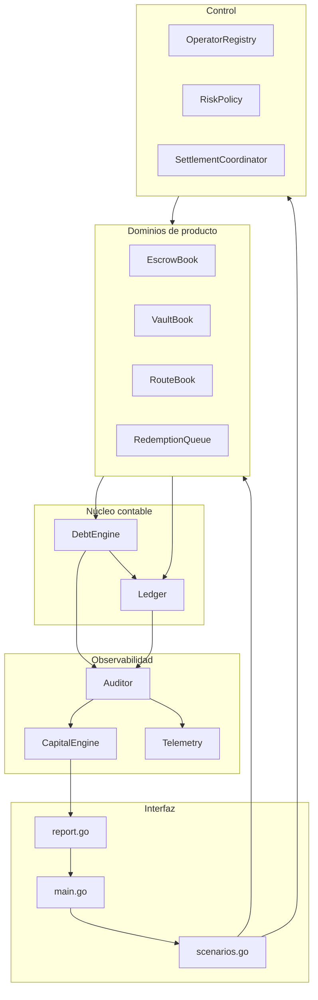
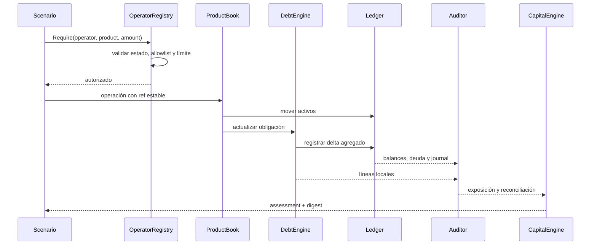
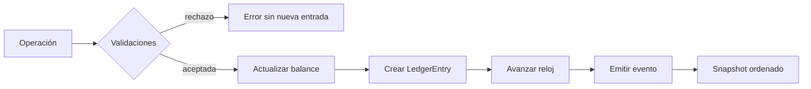
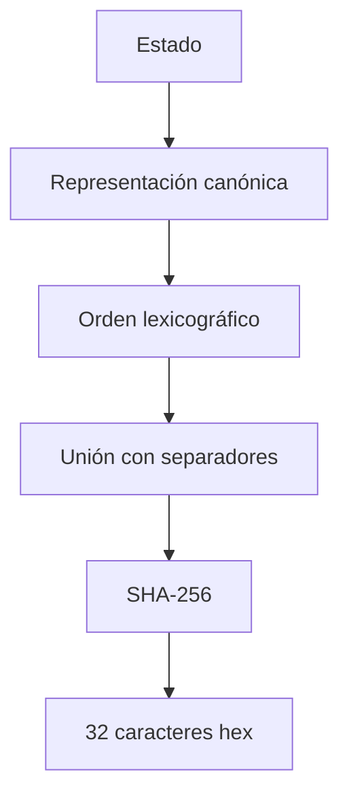

# Arquitectura De MonolithDTL

## Objetivo

MonolithDTL reúne varios libros financieros en un único proceso para mantener
orden total de eventos, consistencia transaccional y una vista de auditoría
reproducible. El monolito es deliberadamente modular: cada dominio controla sus
transiciones, mientras el ledger controla movimientos y entradas contables.

La frontera pública es una CLI sin estado persistente. Cada ejecución crea su
contexto, aplica un escenario y emite un snapshot completo.

## Principios

- **Enteros por activo**: todo importe usa unidades mínimas y `Amount` (`int64`).
- **Orden determinista**: mapas internos se convierten en slices ordenados.
- **Reloj lógico**: los eventos avanzan mediante `Ledger.Tick()`.
- **Responsabilidad local**: cada libro valida su máquina de estados.
- **Contabilidad central**: solo el ledger modifica balances agregados.
- **Reconciliación explícita**: las vistas locales y agregadas se comparan sin
  corrección automática.
- **Decisión cuantitativa**: capital y liquidez producen estados operativos
  trazables.

## Mapa De Componentes



## Propiedad Del Estado

| Estado                | Propietario        | Mutadores autorizados                     | Lectores                     |
| --------------------- | ------------------ | ----------------------------------------- | ---------------------------- |
| balances y activos    | `Ledger`           | `Credit`, `Debit`, `Move`, `Mint`, `Burn` | todos los libros, auditor    |
| deuda agregada        | `Ledger`           | reserva, repayment y release              | debt engine, vaults, auditor |
| obligaciones locales  | `DebtEngine`       | apertura, crédito y liquidación           | productos, auditor           |
| escrows               | `EscrowBook`       | create, release, refund, cancel           | report y auditor             |
| vaults y posiciones   | `VaultBook`        | deposit, borrow, repay, redeem            | redenciones y auditor        |
| rutas y legs          | `RouteBook`        | create, add leg, settle                   | report y auditor             |
| operadores            | `OperatorRegistry` | register, authorize, use, deactivate      | productos y settlement       |
| evaluación de capital | cálculo puro       | `EvaluateCapital`                         | report y telemetría          |

Los módulos de observación no modifican balances ni obligaciones. Esto permite
repetir una evaluación de riesgo sobre un snapshot sin cambiar su resultado.

## Ciclo De Una Operación



Una operación fallida devuelve error y no debe continuar con la siguiente
transición. Los escenarios incluidos emplean `must` únicamente porque son
fixtures deterministas: una integración debe propagar el error y conservar el
contexto de la referencia.

## Identidad Y Referencias

`StableID` deriva un identificador corto desde un prefijo y un conjunto de
campos. No sustituye una firma criptográfica; aporta estabilidad para eventos,
llamadas, rutas y redenciones.

Las referencias de negocio (`ref`) cumplen dos funciones:

1. relacionan la entrada contable con la operación que la originó;
2. permiten reconstruir la secuencia sin depender del orden de un mapa.

Para una incorporación persistente, la capa de almacenamiento debe imponer
unicidad de referencia antes de llamar al dominio.

## Ledger Y Diario



Cada `LedgerEntry` identifica producto, instancia, cuenta, activo, débito,
crédito, delta de deuda, bucket, referencia y memo. El journal no es una base de
datos de doble partida completa, pero sí un rastro causal suficiente para los
escenarios soportados.

## Reconciliación

El sistema conserva dos vistas:

- obligación local: `product + product_id + account + asset`;
- deuda agregada: la vista contable usada por el ledger.

`DebtEngine.Reconcile()` agrupa por cuenta y activo y calcula:

```text
variance = local_outstanding - global_debt
```

Una varianza distinta de cero activa supervisión. El reconciliador no aplica
neteo, no borra entradas y no compensa balances. Cualquier ajuste debe entrar
como operación explícita con referencia y aprobación.

## Digest De Estado

El `state_digest` incluye:

- identidad de protocolo, escenario, red y reloj;
- balances ordenados;
- deuda agregada y obligaciones locales;
- redenciones y rutas;
- digest de la evaluación de capital.



El digest es una huella de consistencia, no una firma ni un mecanismo de
autenticación. Una integración que necesite no repudio debe firmar el documento
completo con una clave gestionada fuera del proceso.

## Extensión Segura

Para añadir un producto:

1. defina su estado y máquina de transiciones;
2. registre un nuevo `ProductKind`;
3. use únicamente métodos públicos del ledger;
4. vincule obligaciones mediante `DebtEngine`;
5. añada límites de operador;
6. incorpore su exposición al motor de capital;
7. amplíe `ScenarioReport` de forma compatible;
8. añada tests unitarios, de CLI e invariantes;
9. documente unidades, errores y recuperación.

No se recomienda que un producto modifique mapas de otro dominio ni que el
auditor ejecute escrituras correctivas.
