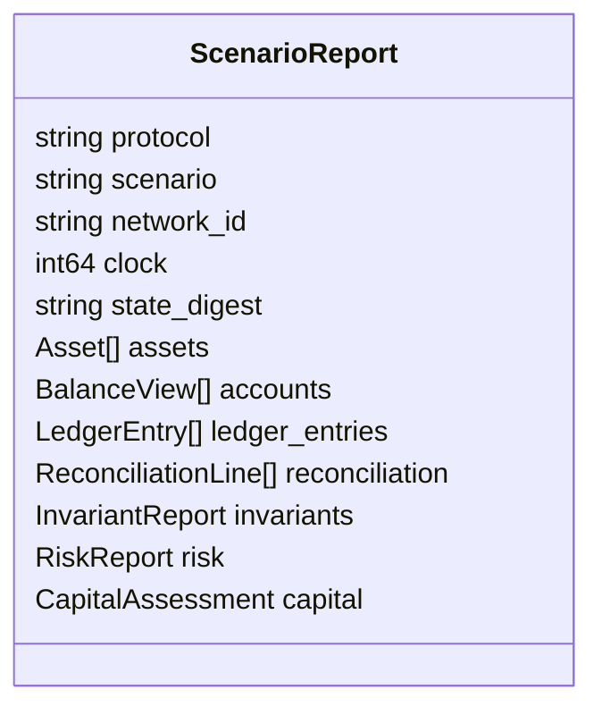
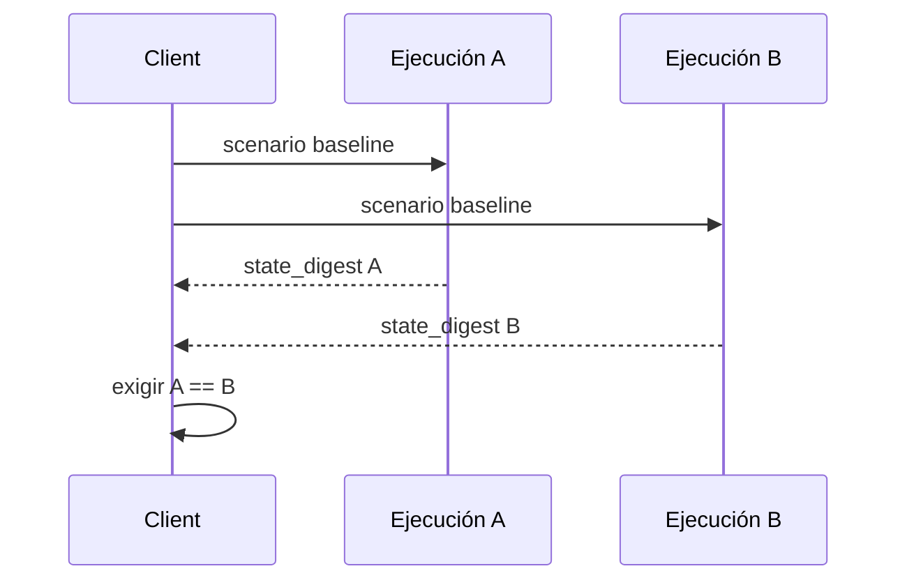

# Integración De La CLI

## Construcción

```bash
npm ci
npm run build
```

El script detecta el sistema operativo y genera:

- Linux: `build/monolithdtl`
- Windows: `build/monolithdtl.exe`

El build usa `go build -trimpath` para no incorporar rutas locales.

## Comandos

```text
monolithdtl --help
monolithdtl --list
monolithdtl scenario <nombre>
monolithdtl scenario=<nombre>
```

| Resultado              | Código de salida | Canal             |
| ---------------------- | ---------------: | ----------------- |
| escenario válido       |              `0` | JSON en `stdout`  |
| comando desconocido    |              `1` | error en `stderr` |
| escenario desconocido  |              `1` | error en `stderr` |
| argumentos incompletos |              `1` | uso en `stderr`   |

No mezcle logs propios con `stdout`: el consumidor debe poder parsear el
documento completo directamente.

## Contrato Superior



Campos obligatorios:

| Campo          | Tipo    | Regla                         |
| -------------- | ------- | ----------------------------- |
| `protocol`     | string  | siempre `MonolithDTL`         |
| `scenario`     | string  | nombre solicitado             |
| `network_id`   | string  | red lógica del snapshot       |
| `clock`        | integer | mayor que cero tras bootstrap |
| `state_digest` | string  | 32 caracteres hex             |
| colecciones    | array   | presentes aunque estén vacías |
| `invariants`   | object  | booleanos de consistencia     |
| `risk`         | object  | agregados operativos          |
| `capital`      | object  | assessment, ladder y digest   |

Los consumidores deben ignorar campos desconocidos para permitir extensiones
compatibles dentro de la línea `1.x`.

## Ejemplo TypeScript

```ts
import { spawnSync } from "node:child_process";

type Decision = "open" | "restricted" | "halted";

type Report = {
  protocol: "MonolithDTL";
  scenario: string;
  state_digest: string;
  capital: {
    decision: Decision;
    required_capital: number;
    available_capital: number;
    digest: string;
  };
};

const result = spawnSync("build/monolithdtl", ["scenario", "baseline"], {
  encoding: "utf8",
  shell: false,
});

if (result.status !== 0) throw new Error(result.stderr.trim());
const report = JSON.parse(result.stdout) as Report;
if (report.protocol !== "MonolithDTL") throw new Error("unexpected protocol");
if (!/^[0-9a-f]{32}$/.test(report.state_digest)) throw new Error("invalid digest");
```

En Windows, seleccione `build/monolithdtl.exe`. Evite `shell: true` y pase los
argumentos como array.

## Determinismo

Una comparación reproducible debe fijar:

- commit del repositorio;
- versión del binario;
- nombre del escenario;
- plataforma y arquitectura;
- salida JSON completa.



El digest permite detectar diferencias, pero el diagnóstico exige comparar
colecciones, entradas y parámetros de capital.

## Validación De Esquema

Antes de aceptar una respuesta:

1. compruebe el código de salida;
2. parse `stdout` una sola vez;
3. valide identidad, escenario y patrón de digest;
4. exija que las invariantes críticas sean booleanas;
5. trate `restricted` y `halted` como estados no ordinarios;
6. conserve el JSON original para auditoría.

## Compatibilidad

La línea `1.x` mantiene nombres y tipos de campos existentes. Un cambio que
renombre, elimine o altere unidades requiere una nueva versión mayor. Añadir un
campo opcional o una métrica mantiene compatibilidad siempre que no cambie los
resultados financieros previos.
