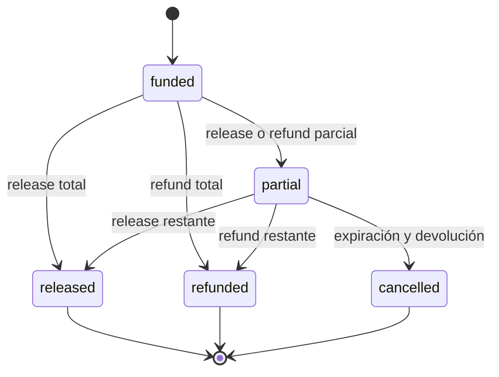
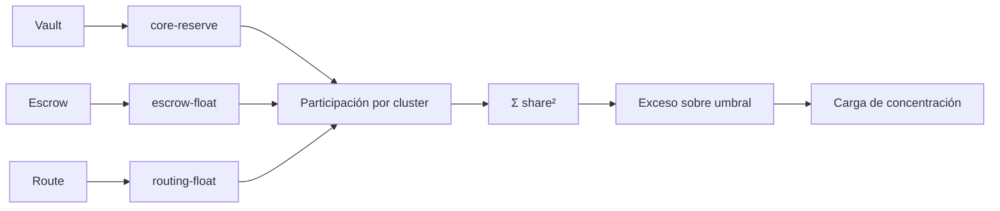
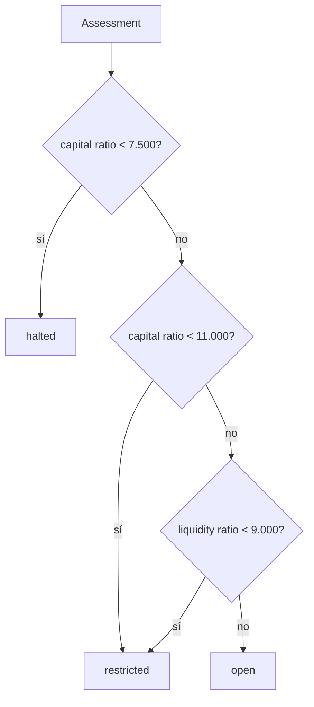

# Modelo Económico Y De Capital

## Unidades

`Amount` es un entero con signo. Cada activo declara sus decimales:

| Activo | Decimales |      Unidad mínima |
| ------ | --------: | -----------------: |
| `mUSD` |         6 |    `0,000001 mUSD` |
| `mEUR` |         6 |    `0,000001 mEUR` |
| `rSOL` |         9 | `0,000000001 rSOL` |
| `vUSD` |         6 |    `0,000001 vUSD` |

Las funciones de basis points usan denominador `10.000` y redondeo entero hacia
cero. Los cálculos no convierten a coma flotante.

## Vaults

En el primer depósito, activos y shares se crean 1:1. Después:

```text
shares_minted = deposit × total_shares / total_assets
gross_out     = shares_burned × total_assets / total_shares
fee           = gross_out × fee_bps / 10_000
net_out       = gross_out - fee
```

El crédito máximo de una posición usa su fracción del vault y un factor de
admisión del 70 %:

```text
position_assets = total_assets × position_shares / total_shares
max_borrow      = position_assets × 7_000 / 10_000
```

Ejemplo: con `2.400.000.000` unidades de activos y shares, una posición con
`1.000.000.000` shares representa `1.000.000.000` unidades. Su crédito máximo
es `700.000.000`.

## Escrow

Un escrow bloquea `amount + fee` en la reserva. El principal puede liberarse al
beneficiario o devolverse al depositante. La comisión se captura de forma
separada por tesorería, lo que permite auditar tres flujos:

```text
funded = amount + fee
released + refunded <= amount
captured_fee <= fee
```



## Operadores

Cada operador combina:

- estado activo;
- productos permitidos;
- límite diario absoluto;
- cap específico por producto;
- utilización acumulada.

La admisión exige:

```text
active == true
product ∈ allowed_products
used_today + requested_amount <= daily_limit
product_cap_bps > 0
```

El consumo se registra antes de la transición de producto para que el reporte
muestre la utilización que autorizó la operación.

## Exposición De Capital

Una `RiskExposure` contiene notional, probabilidad, recuperación, volatilidad,
porcentaje líquido, horizonte y cluster. El motor normaliza todos los BPS al
rango `[0, 10.000]`.

### Pérdida Esperada

```text
EL_i = E_i × PD_i × (10.000 - Recovery_i) / 10.000²
```

Para `E = 1.000.000.000`, `PD = 100 bps` y recuperación del 50 %:

```text
EL = 1.000.000.000 × 0,01 × 0,50 = 5.000.000
```

### Estrés De Mercado

```text
Market_i = E_i × Vol_i × sqrt(days_i) × stress_multiplier
```

La raíz cuadrada se calcula por búsqueda entera. El horizonte se expresa como
un factor BPS, de modo que un día equivale a `10.000` y nueve días a `30.000`.

### Liquidez

```text
gap_bps    = 10.000 - liquidity_bps
charge_bps = min(max_charge, gap_bps + days × day_charge)
Liq_i      = E_i × charge_bps / 10.000
```

El porcentaje líquido representa la fracción que puede movilizarse dentro del
horizonte indicado. El cap evita que una carga aislada exceda la política.

### Concentración HHI

```text
share_g = cluster_notional_g / gross_exposure
HHI_ppm = Σ share_g² × 1.000.000
```

| Distribución            |             HHI |
| ----------------------- | --------------: |
| un cluster              | `1.000.000 ppm` |
| dos clusters al 50 %    |   `500.000 ppm` |
| cuatro clusters al 25 % |   `250.000 ppm` |

La carga se aplica solo sobre el exceso respecto al umbral:

```text
excess_ppm = max(HHI_ppm - threshold_ppm, 0)
charge_bps = excess_ppm × concentration_factor_bps / 1.000.000
Concentration = gross_exposure × charge_bps / 10.000
```



## Capital Requerido

```text
required_capital =
    expected_loss
  + market_stress
  + liquidity_charge
  + concentration_charge
  + operational_charge
```

El riesgo operativo es un porcentaje fijo del gross exposure. El capital
disponible se obtiene de las cuentas de seguro y tesorería en `mUSD`.

### Decisión

La política por defecto usa:

| Parámetro                    |         Valor |
| ---------------------------- | ------------: |
| ratio mínimo de capital      |  `11.000 bps` |
| ratio de detención           |   `7.500 bps` |
| cobertura mínima de liquidez |   `9.000 bps` |
| multiplicador de estrés      |  `14.000 bps` |
| umbral HHI                   | `350.000 ppm` |
| carga operativa              |      `75 bps` |



`restricted` señala que deben limitarse nuevas exposiciones y revisarse los
drivers. `halted` exige detener admisiones hasta recuperar capital o reducir
riesgo. El motor calcula; la capa operativa decide qué acciones concretas
aplicar.

## Escalera De Estrés

El required capital base se multiplica por cuatro shocks:

| Punto     | Multiplicador |
| --------- | ------------: |
| `base`    |         100 % |
| `adverse` |         125 % |
| `severe`  |         150 % |
| `reverse` |         200 % |

Cada punto recalcula el ratio de capital y su decisión. La escalera debe cumplir:

```text
required[i] < required[i + 1]
capital_ratio[i] >= capital_ratio[i + 1]
```

El digest de capital incorpora cargas ordenadas y todos los puntos, por lo que
un cambio de parámetro, notional o clasificación altera la huella final.

## Límites Del Modelo

- No estima precios externos ni volatilidad histórica.
- No aplica correlaciones entre buckets mediante una matriz completa.
- No descuenta flujos por una curva temporal.
- No sustituye un motor regulatorio ni una valoración independiente.

Estos límites son explícitos: los parámetros son entradas de política y los
resultados deben revisarse junto con reconciliación, límites y eventos.
