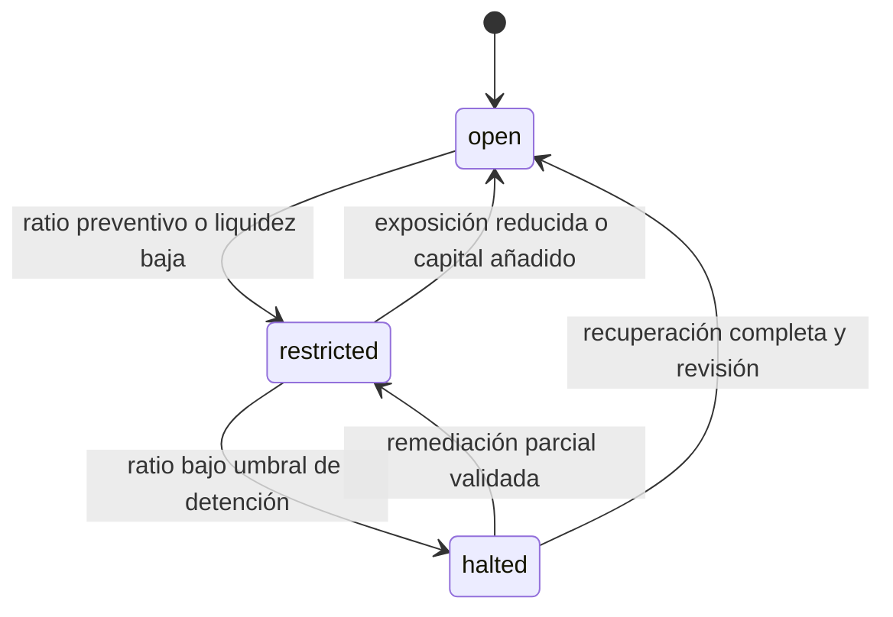
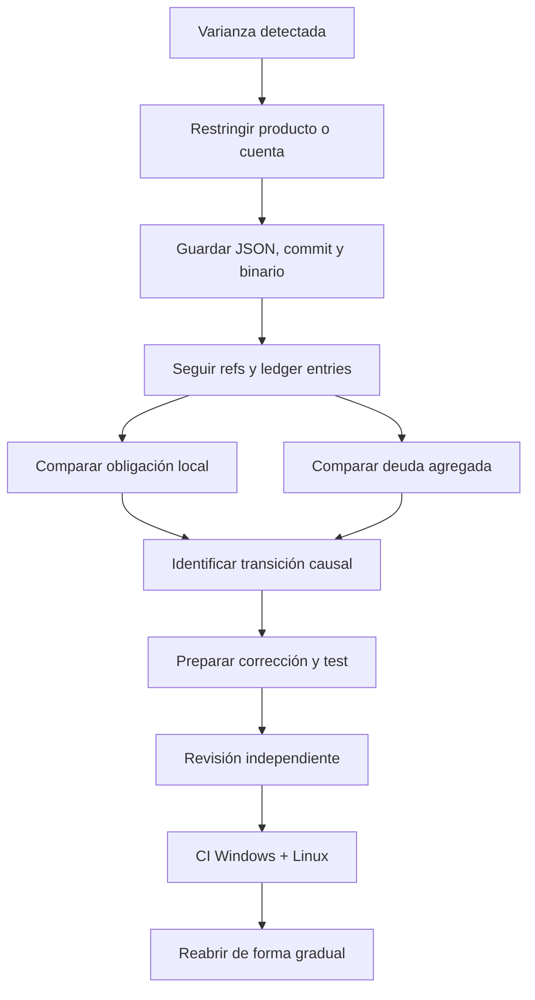
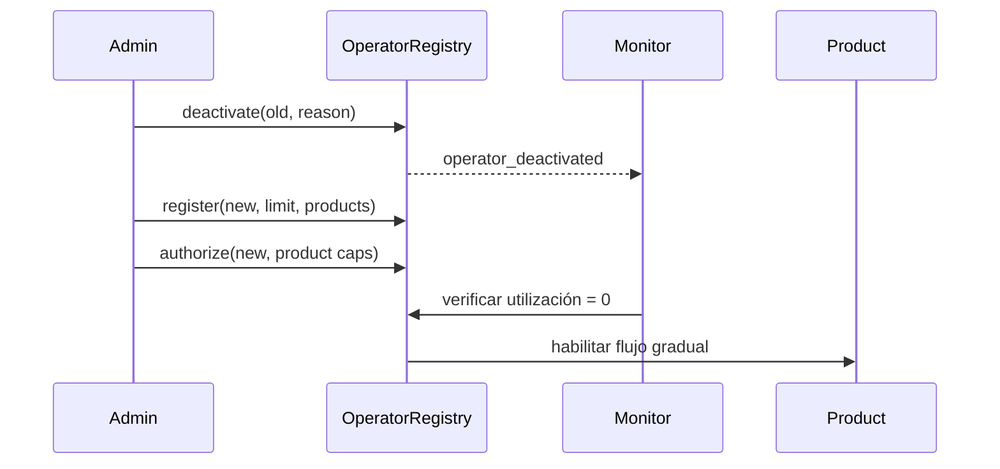
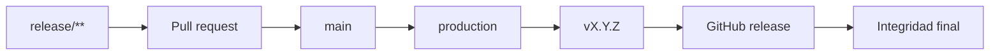

# Operación Y Runbooks

## Estados Operativos

MonolithDTL separa el resultado funcional de una operación del estado de riesgo
de la cartera. Una ejecución puede completar sus transiciones y producir un
assessment `restricted` si la holgura de capital o liquidez cae bajo el umbral.



| Estado       | Nuevas operaciones             | Acción requerida                      |
| ------------ | ------------------------------ | ------------------------------------- |
| `open`       | normales dentro de límites     | monitorización                        |
| `restricted` | limitar exposición incremental | revisar drivers y aprobar excepciones |
| `halted`     | detener admisiones             | preservar evidencia y remediar        |

## Arranque Verificado

```bash
git status --short
npm ci
npm run ci
npm run build
build/monolithdtl scenario baseline > baseline.json
```

Compruebe:

- estado Git limpio;
- versión `1.0.0` en package y lockfile;
- CI local completa;
- `state_digest` válido;
- invariantes verdaderas para el escenario base;
- capital y liquidez por encima de los umbrales.

## Monitorización

Métricas mínimas:

| Métrica                        | Interpretación              | Umbral inicial         |
| ------------------------------ | --------------------------- | ---------------------- |
| `risk.local_debt`              | obligaciones abiertas       | tendencia por producto |
| `risk.global_debt`             | deuda agregada              | comparar con local     |
| `risk.reconciliation_variance` | diferencia de conciliación  | `0`                    |
| `risk.reserve_variance`        | varianza en reservas        | `0`                    |
| `capital.required`             | capital calculado           | bajo available         |
| `capital.available`            | seguro + tesorería          | por encima del mínimo  |
| `reconcile.drift`              | detalle por cuenta y activo | `0`                    |

No alerte únicamente por volumen. Una subida de exposición puede ser válida si
capital, liquidez, límites e invariantes mantienen holgura.

## Runbook De Reconciliación



Nunca modifique directamente un mapa para hacer desaparecer una varianza. Use
una transición de negocio o una entrada compensatoria explícita, documentada y
aprobada.

## Runbook De Capital

Para `restricted`:

1. identifique la mayor `ExposureCharge`;
2. revise HHI y clusters dominantes;
3. compare base, adverse, severe y reverse;
4. reduzca admisiones del driver dominante;
5. evalúe capital adicional o vencimiento de exposición;
6. repita el assessment con los mismos parámetros.

Para `halted`:

1. detenga nuevas exposiciones;
2. conserve el snapshot que originó la decisión;
3. verifique que no exista error de unidad o parámetro;
4. establezca un plan de reducción o recapitalización;
5. exija dos revisiones antes de reabrir;
6. pase primero por `restricted` salvo recuperación completa demostrable.

## Rotación De Operador



Antes de reemplazar un operador, confirme que no existan batches creados que
dependan de su identidad. La utilización histórica permanece en los eventos.

## Recuperación De Un Escenario Fallido

La CLI construye el contexto en memoria, por lo que un fallo no deja estado
persistente. Para reproducir:

```bash
build/monolithdtl scenario <nombre> > observed.json
sha256sum build/monolithdtl
git rev-parse HEAD
```

En PowerShell:

```powershell
build\monolithdtl.exe scenario <nombre> | Set-Content observed.json
Get-FileHash build\monolithdtl.exe -Algorithm SHA256
git rev-parse HEAD
```

Conserve salida, error, hash de binario, commit, SO y arquitectura.

## Release

Secuencia mínima:

1. CI verde en la rama `release/**`;
2. pull request revisado y fusionado;
3. CI verde sobre `main`;
4. rama `production` apuntando al mismo commit;
5. tag anotado `vX.Y.Z` sobre ese commit;
6. CI verde del tag;
7. release de GitHub publicada;
8. control de integridad del evento `release` verde.



No anuncie la entrega mientras los cuatro refs o estados no converjan en el
mismo commit y sus checks no hayan terminado.
