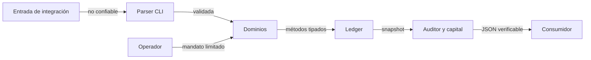
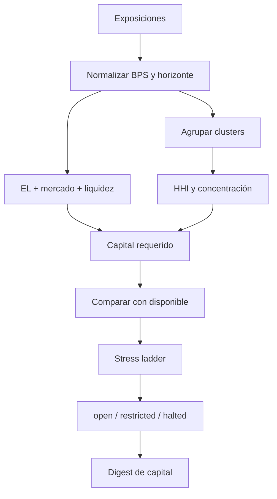
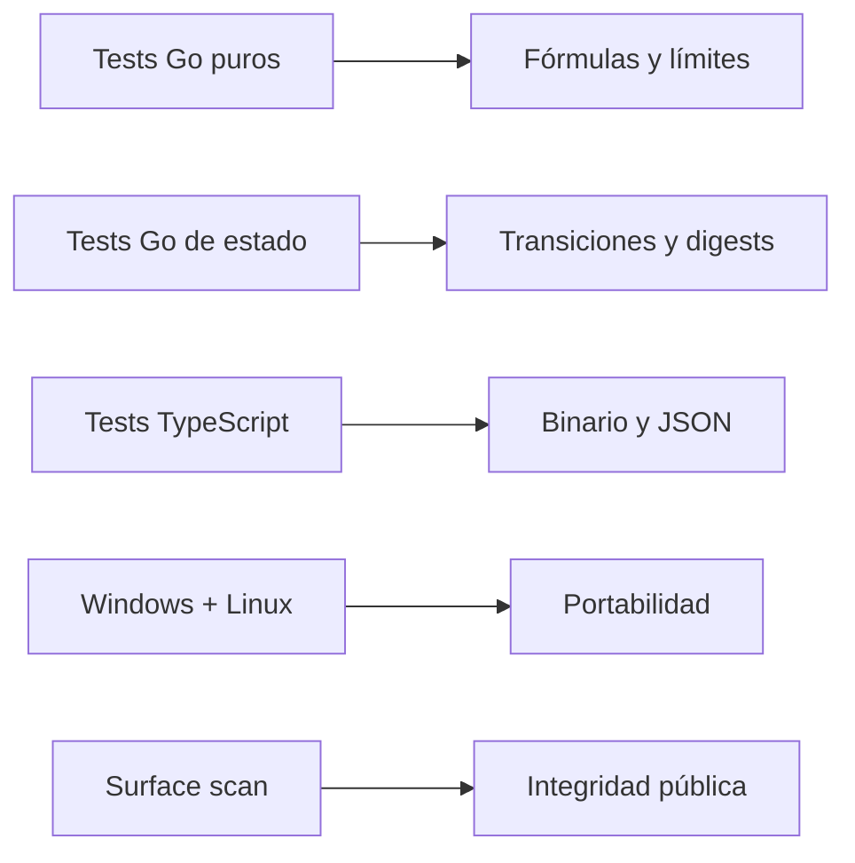

# Seguridad Y Gestión De Riesgo

## Activos Protegidos

- balances y reservas por cuenta y activo;
- obligaciones locales y deuda agregada;
- shares, posiciones y redenciones;
- fondos de escrow y comisiones;
- rutas, legs y destinatarios;
- límites y mandatos de operadores;
- parámetros y resultados de capital;
- integridad de reportes y digests.

## Fronteras De Confianza

La CLI no autentica identidades externas; recibe nombres de escenarios
predefinidos. En una integración con solicitudes arbitrarias, autenticación,
autorización y rate limiting pertenecen a la capa de borde.

## Amenazas Y Controles

| Amenaza                | Vector                       | Control preventivo             | Evidencia                   |
| ---------------------- | ---------------------------- | ------------------------------ | --------------------------- |
| saldo negativo         | débito superior al balance   | `Ledger.Debit`                 | error y ausencia de entrada |
| doble ejecución        | referencia reutilizada       | unicidad en capa persistente   | lookup de `ref`             |
| operador excesivo      | acumulación diaria           | `DailyLimit` y caps            | `used_today` y eventos      |
| ruta incompleta        | legs no conservativas        | validación de suma y `min_out` | `routes_conserved`          |
| redención no admisible | deuda o shares insuficientes | guard de redención             | request rechazado           |
| exposición concentrada | un cluster domina            | HHI y charge                   | `concentration_hhi_ppm`     |
| iliquidez              | horizonte y liquid share     | liquidity charge               | coverage ratio              |
| cambio no determinista | iteración de mapas           | orden canónico                 | digest reproducible         |
| material sensible      | inclusión accidental         | scan de superficie             | workflow de integridad      |

## Controles De Cantidad

Las funciones `Add` y `Sub` saturan en `MaxAmount`. `MulBps`, `RatioBps` y
`ShareOf` operan sobre enteros. Antes de ampliar los rangos de producción debe
revisarse el máximo producto intermedio, no solo el resultado final.

Reglas:

- rechazar cantidades no positivas en entradas económicas;
- aplicar caps BPS entre `0` y `10.000`;
- usar `Positive` solo cuando truncar valores negativos sea una decisión de
  dominio explícita;
- documentar siempre el orden de redondeo;
- probar límites, cero, dust y valores máximos.

## Control De Capital

El assessment es puro: no pausa productos automáticamente. Esta separación
permite revisión, testing y políticas distintas de actuación sin cambiar la
aritmética financiera.

## Reconciliación Como Detección

La conciliación compara obligaciones locales con deuda agregada por cuenta y
activo. Una diferencia puede indicar transición incompleta, orden incorrecto,
ajuste manual o fallo de integración.

Procedimiento:

1. localizar `ReconciliationLine` no nula;
2. reunir `LedgerEntry` con la misma cuenta y activo;
3. ordenar por `clock` y correlacionar `ref`;
4. comparar con eventos del libro de producto;
5. identificar el primer punto de divergencia;
6. detener el ámbito antes de compensar.

La existencia de una alerta no autoriza a netear productos ni cuentas.

## Estrategia De Pruebas

Cobertura mínima para cambios económicos:

- caso nominal con resultado exacto;
- cero y valores negativos;
- límites BPS;
- monotonía ante mayor exposición o shock;
- independencia del orden de entrada;
- decisión en cada frontera;
- digest diferente si cambia un driver;
- contrato CLI real, no un mock.

## Gestión De Secretos

El repositorio no requiere claves, tokens ni endpoints. Si una integración
añade servicios externos:

- use secretos del entorno de ejecución;
- no escriba valores en JSON, eventos o errores;
- limite permisos por servicio y entorno;
- rote tras cualquier exposición;
- haga que el scanner detecte el nuevo formato.

## Supply Chain

La dependencia Node.js es de desarrollo. `package-lock.json` fija la resolución
y CI usa `npm ci`. Las actions oficiales están versionadas por major estable.
Antes de una release revise cambios del lockfile, versión de Go y permisos de
workflows.

## Criterio De Release

Una versión no debe publicarse si:

- falla formato, vet, tests o build;
- Windows y Linux no validan el mismo commit;
- el scanner encuentra material sensible;
- package y lockfile difieren de versión;
- faltan documentación o banner;
- existen artefactos generados versionados;
- `main`, `production` y tag no convergen.

La publicación es un estado verificable, no una inferencia basada únicamente
en un build local correcto.
